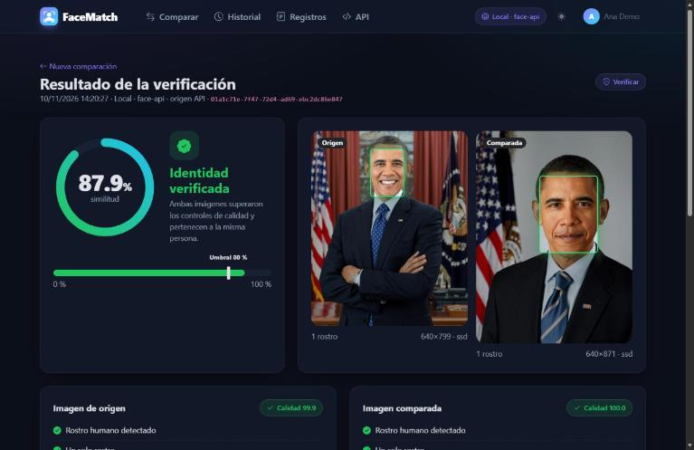
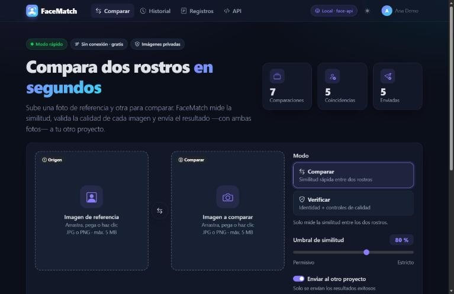
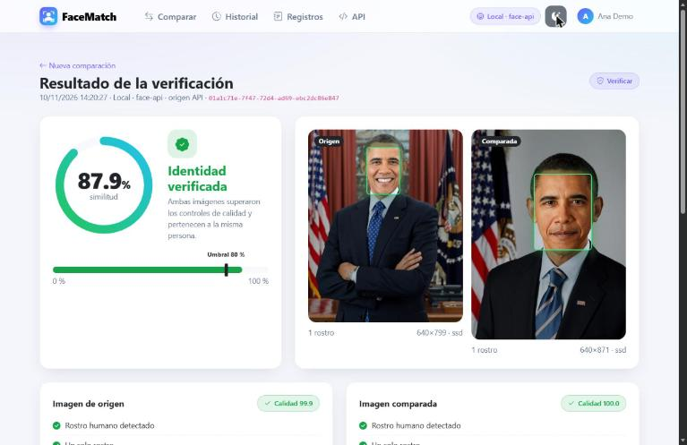
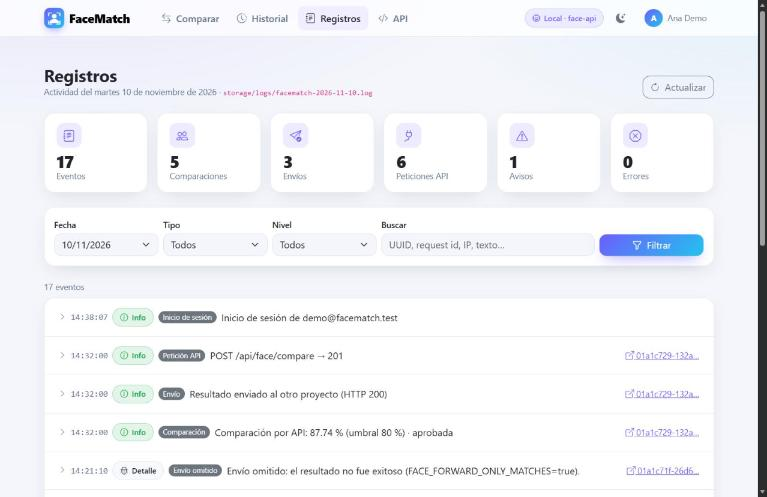
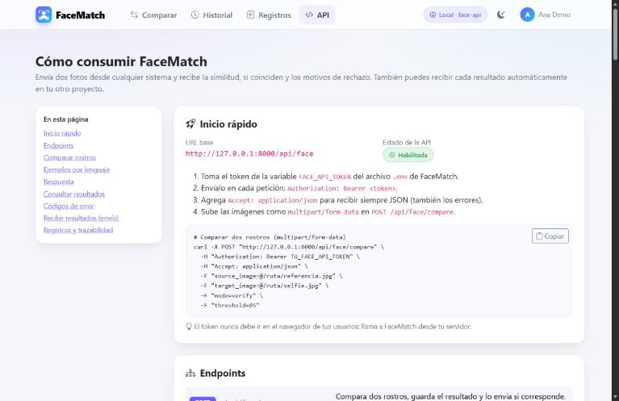

# FaceMatch

**Comparación y verificación facial autoalojada, con Laravel.** Sube dos fotos y FaceMatch te dice si son de la misma persona, con qué similitud y, en el modo Verificar, si cada foto tiene calidad suficiente (rostro único, nitidez, brillo, pose, ojos abiertos). El resultado puede enviarse automáticamente, junto con ambas imágenes, a otro sistema.

Funciona **gratis y sin conexión** con un motor local basado en [face-api](https://github.com/vladmandic/face-api) y TensorFlow.js, o con **Amazon Rekognition** si lo prefieres.

[](https://github.com/Romanls11/facematch/actions/workflows/tests.yml)




## Características

- 🧑‍🤝‍🧑 **Dos modos:** *Comparar* (similitud) y *Verificar* (similitud + 8 controles de calidad por foto).
- 💻 **Motor local gratuito:** sin registro, sin llaves y sin enviar fotos a terceros. TensorFlow.js con backend WASM: funciona igual en Windows, Linux y macOS.
- ⚡ **Modo rápido:** servicio Node persistente (`php artisan face:serve`) con varios workers; ~0.2 s por comparación.
- ☁️ **Amazon Rekognition** opcional, con modo simulado para desarrollar sin AWS.
- 🔐 **Privado por diseño:** login obligatorio, fotos fuera de `public/` y URLs firmadas que caducan.
- 🔌 **API REST** con token Bearer, límite de peticiones y ejemplos en cURL, PHP, JavaScript y Python.
- 📤 **Envío automático** del resultado y ambas fotos a tu otro sistema (multipart + Bearer).
- 📜 **Registro de actividad** en JSON con visor y filtros: comparaciones, envíos, llamadas a la API y accesos.
- 🌗 Interfaz en **español** con Bootstrap 5.3, modo claro y oscuro.

## Capturas

| Portada | Resultado (tema claro) |
|---|---|
|  |  |
| **Registros** | **Guía de la API** |
|  |  |

Las fotos de ejemplo son retratos oficiales de dominio público ([ver origen](tests/Fixtures/faces/README.md)).

## Inicio rápido

Requisitos: PHP 8.4+ (con `pdo_pgsql`), Composer, Node 18+ y PostgreSQL 14+.

```bash
git clone https://github.com/Romanls11/facematch.git
cd facematch
composer install
npm install

cp .env.example .env
php artisan key:generate
php artisan facematch:tokens        # genera los tokens del servicio y de la API
# Edita DB_* en el .env (y FACE_NODE_BINARY en Windows)

php artisan migrate
npm run build
php artisan facematch:user          # crea tu usuario (no hay registro público)

php artisan serve                   # http://127.0.0.1:8000
php artisan face:serve              # en otra terminal: motor en modo rápido
```

La guía completa, con Windows y solución de problemas, está en **[docs/instalacion.md](docs/instalacion.md)**.

## Uso de la API

```bash
curl -X POST http://127.0.0.1:8000/api/face/compare \
  -H "Authorization: Bearer $FACE_API_TOKEN" \
  -H "Accept: application/json" \
  -F source_image=@referencia.jpg \
  -F target_image=@selfie.jpg \
  -F mode=verify
```

```json
{
  "data": {
    "uuid": "01a1c705-c0fd-7271-86a4-7ef91851021b",
    "passed": true,
    "is_match": true,
    "similarity": 87.74,
    "threshold": 80,
    "failure_reasons": [],
    "forward": { "status": "sent", "http_code": 200 },
    "…": "…"
  }
}
```

Usa `passed` para decidir. Si no aprueba, `failure_reasons` explica por qué en español. Más en **[docs/api.md](docs/api.md)** o, con la aplicación en marcha, en el menú **API**.

## Documentación

| Documento | Contenido |
|---|---|
| [Instalación](docs/instalacion.md) | Requisitos, pasos, Windows, problemas frecuentes, actualización |
| [Configuración](docs/configuracion.md) | Todas las variables de entorno |
| [Motores faciales](docs/motores.md) | Cómo funciona el motor local, controles de calidad, `face:serve`, Rekognition |
| [API REST](docs/api.md) | Endpoints, parámetros, respuestas, errores y ejemplos |
| [Envío a otro proyecto](docs/envio.md) | Formato de la petición y receptores de ejemplo |
| [Registros](docs/registros.md) | Eventos, formato y consulta |
| [Seguridad y privacidad](docs/seguridad.md) | Usuarios, imágenes privadas, tokens, lista para producción |
| [Arquitectura](docs/arquitectura.md) | Flujo, estructura del código, modelo de datos y decisiones |
| [Despliegue](docs/despliegue.md) | Nginx, PHP-FPM, systemd, copias de seguridad, Windows Server |

## Comandos

| Comando | Descripción |
|---|---|
| `php artisan face:serve [--workers=2] [--port=3311]` | Inicia el motor facial en modo rápido |
| `php artisan facematch:user [correo] [--list] [--delete]` | Crea, actualiza, lista o elimina usuarios |
| `php artisan facematch:tokens [--force]` | Genera `FACE_SERVICE_TOKEN` y `FACE_API_TOKEN` |
| `node scripts/face-engine.cjs a.jpg b.jpg [tiny\|ssd]` | Compara dos fotos desde la consola (JSON) |

## Pruebas

```bash
php artisan test                         # unitarias y de feature (motor simulado)
php artisan test --group=integration     # motor real con las fotos de tests/Fixtures/faces
vendor/bin/pint --test                   # estilo
```

## Uso responsable

FaceMatch procesa **datos biométricos**. Antes de usarlo con personas reales:

- Informa a las personas y obtén su consentimiento según la ley aplicable (GDPR, LFPDPPP, LGPD, BIPA…).
- Define cuánto tiempo conservas las fotos y los registros.
- Úsalo como apoyo a una decisión, no como único criterio: el reconocimiento facial puede fallar y tiene sesgos conocidos.

Más en [docs/seguridad.md](docs/seguridad.md).

## Contribuir

Las contribuciones son bienvenidas. Lee [CONTRIBUTING.md](CONTRIBUTING.md) antes de abrir un *pull request*. Para reportar una vulnerabilidad, sigue [SECURITY.md](SECURITY.md) (no abras un issue público).

Historial de cambios: [CHANGELOG.md](CHANGELOG.md).

## Créditos

- [Laravel](https://laravel.com), [Bootstrap](https://getbootstrap.com) y [Bootstrap Icons](https://icons.getbootstrap.com).
- [@vladmandic/face-api](https://github.com/vladmandic/face-api) y [TensorFlow.js](https://www.tensorflow.org/js).
- [sharp](https://sharp.pixelplumbing.com) para decodificar imágenes.
- [olorunda/laravel-rekognition-face](https://packagist.org/packages/olorunda/laravel-rekognition-face) para Amazon Rekognition.

## Licencia

[MIT](LICENSE).
