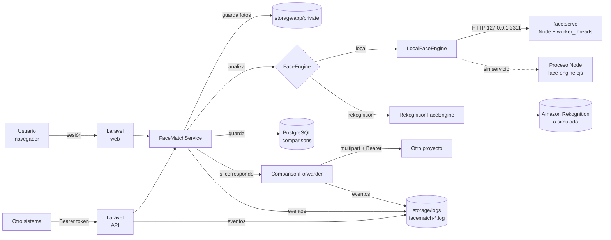
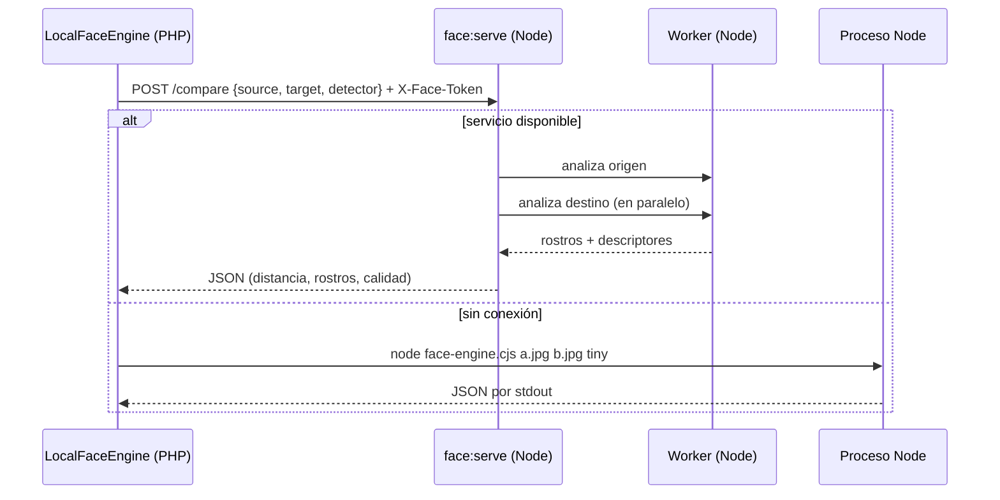

# Arquitectura

## Visión general



## Flujo de una comparación

1. **Entrada.** La web (`ComparisonController@store`) o la API (`Api\FaceCompareController@store`) validan la petición con `CompareFacesRequest`: dos imágenes JPG/PNG ≤ 5 MB, `mode`, `threshold` y `forward`.
2. **Almacenamiento.** `FaceMatchService::compare()` guarda las fotos en el disco privado como `comparisons/AAAA/MM/<uuid>.<ext>`.
3. **Análisis.** El motor configurado (`FaceEngine`) devuelve un `FaceAnalysis`. Si falla, se borran las fotos, se registra `comparison.failed` y se lanza `FaceEngineException` (la API responde `502`).
4. **Persistencia.** Se crea el modelo `Comparison` con la similitud, el resultado y el detalle completo en `result` (JSON).
5. **Registro.** Se escribe `comparison.created`.
6. **Envío.** Si corresponde, `ComparisonForwarder` hace el `POST multipart` al otro proyecto y guarda el estado (`sent`, `failed`, `skipped`).
7. **Respuesta.** La web redirige al detalle; la API responde `201` con el resultado y URLs firmadas.

## Motor local: dos transportes



`scripts/face-engine.cjs` es un único archivo con tres modos: CLI, servidor (`--serve`) y worker. Así la lógica de análisis no se duplica.

## Estructura del código

```text
app/
├── Console/Commands/
│   ├── FaceServe.php            php artisan face:serve
│   ├── FaceTokens.php           php artisan facematch:tokens
│   └── FaceUser.php             php artisan facematch:user
├── FaceEngines/
│   ├── FaceEngine.php           interfaz común
│   ├── FaceAnalysis.php         resultado inmutable
│   ├── FaceEngineException.php
│   ├── LocalFaceEngine.php      face-api (servicio o proceso) + controles de calidad
│   └── RekognitionFaceEngine.php
├── Http/
│   ├── Controllers/
│   │   ├── Api/FaceCompareController.php   API REST
│   │   ├── Auth/LoginController.php        login / logout
│   │   ├── ActivityLogController.php       /registros
│   │   ├── ComparisonController.php        interfaz web
│   │   └── ComparisonImageController.php   imágenes privadas
│   ├── Middleware/
│   │   ├── AssignRequestId.php             X-Request-Id
│   │   ├── EnsureFaceApiToken.php          Bearer de la API
│   │   └── LogApiRequest.php               registro de cada llamada
│   └── Requests/CompareFacesRequest.php
├── Models/
│   ├── Comparison.php           UUID como clave de ruta, URLs de imágenes
│   └── User.php
├── Providers/AppServiceProvider.php        motor, límite de la API, vistas
├── Services/
│   ├── FaceMatchService.php     orquesta guardar → analizar → registrar → enviar
│   └── ComparisonForwarder.php  envío multipart al otro proyecto
└── Support/
    ├── ActivityLog.php          escribir y leer el registro de actividad
    └── ApiExamples.php          ejemplos de /api-docs
config/facematch.php             configuración y límites de calidad
scripts/face-engine.cjs          motor Node: CLI, servicio y worker
resources/views/                 Blade + Bootstrap 5.3
resources/js/app.js              tema, zonas de arrastre, animaciones
tests/                           pruebas (Feature, Unit, fotos de dominio público)
```

## Modelo de datos

Tabla `comparisons`:

| Columna | Tipo | Descripción |
|---|---|---|
| `id` | bigint | Clave primaria interna. |
| `uuid` | uuid, único | Identificador público (URLs, API, envío). |
| `mode` | string | `compare` o `verify`. |
| `origin` | string | `web` o `api`. |
| `engine` | string | `local` o `rekognition`. |
| `source_path`, `target_path` | string | Rutas en el disco privado. |
| `threshold`, `similarity` | decimal | Porcentajes 0–100. |
| `is_match`, `passed` | boolean | Ver [api.md](api.md#post-apifacecompare). |
| `failure_reasons` | json | Motivos en español. |
| `result` | json | Detalle del motor. |
| `forward_status` | string | `pending`, `sent`, `failed`, `skipped`. |
| `forward_http_code`, `forward_response`, `forwarded_at` | — | Resultado del último envío. |
| `created_at`, `updated_at` | timestamp | |

Además: `users`, `sessions`, `cache` y `jobs` estándar de Laravel.

## Decisiones de diseño

| Decisión | Motivo |
|---|---|
| TensorFlow.js con backend **WASM** en lugar de `tfjs-node` | Funciona igual en Windows, Linux y macOS sin compilar nada. |
| Servicio Node persistente opcional | Cargar los modelos tarda ~0.3–3 s; con el servicio se hace una sola vez. Sin él la app sigue funcionando. |
| `sharp.cache(false)` | En Windows la caché de sharp mantiene los archivos bloqueados y Laravel no puede borrarlos. |
| Resultado con el mismo formato en ambos motores | La interfaz, la API y el envío no dependen del motor. |
| UUID como identificador público | No revela cuántas comparaciones hay ni permite adivinar otras. |
| Disco privado + URLs firmadas | Las fotos nunca son públicas, pero los sistemas externos pueden descargarlas temporalmente. |
| Registro JSON por línea | Fácil de leer en `/registros` y de enviar a cualquier sistema de logs. |
